<a href="https://thalys.btreedevs.com.br">
  <picture>
    <source media="(prefers-color-scheme: dark)" srcset="assets/header-dark.svg">
    
  </picture>
</a>

  <a href="https://thalys.btreedevs.com.br"><picture><source media="(prefers-color-scheme: dark)" srcset="assets/btn-portfolio-dark.svg">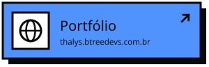</picture></a>
  <a href="https://thalys.btreedevs.com.br/blog"><picture><source media="(prefers-color-scheme: dark)" srcset="assets/btn-blog-dark.svg">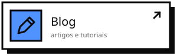</picture></a>
  <a href="https://www.behance.net/thalysmarquesc"><picture><source media="(prefers-color-scheme: dark)" srcset="assets/btn-behance-dark.svg">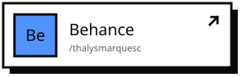</picture></a>
  <a href="https://www.instagram.com/thalysmarquesc"><picture><source media="(prefers-color-scheme: dark)" srcset="assets/btn-instagram-dark.svg"></picture></a>

 

<picture><source media="(prefers-color-scheme: dark)" srcset="assets/section-sobre-dark.svg">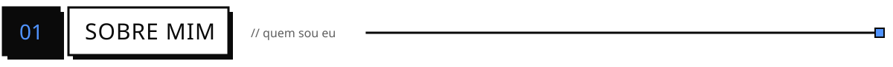</picture>

<picture>
  <source media="(prefers-color-scheme: dark)" srcset="assets/about-dark.svg">
  
</picture>

  

<picture><source media="(prefers-color-scheme: dark)" srcset="assets/section-stack-dark.svg">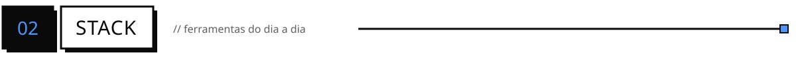</picture>

  <picture>
    <source media="(prefers-color-scheme: dark)" srcset="https://skillicons.dev/icons?i=ts%2Cjs%2Creact%2Cnextjs%2Cvue%2Cangular%2Ctailwind%2Cnodejs%2Cpython%2Cfastapi%2Cgo%2Cdotnet%2Cflutter%2Cdart%2Ckotlin%2Cmongodb%2Cpostgres%2Cdocker%2Cgithubactions%2Cfigma%2Cxd&perline=11&theme=dark">
    
  </picture>

 

<picture><source media="(prefers-color-scheme: dark)" srcset="assets/section-projetos-dark.svg">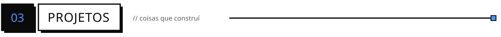</picture>

  <a href="https://atlastreino.com"><picture><source media="(prefers-color-scheme: dark)" srcset="assets/card-atlas-dark.svg"></picture></a>
  <picture><source media="(prefers-color-scheme: dark)" srcset="assets/card-concord-dark.svg">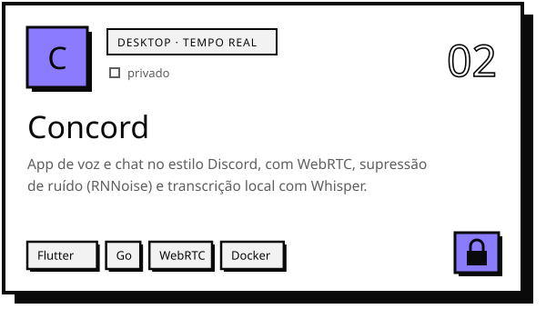</picture>
  <a href="https://rachinha.com"><picture><source media="(prefers-color-scheme: dark)" srcset="assets/card-rachinha-dark.svg"></picture></a>
  <picture><source media="(prefers-color-scheme: dark)" srcset="assets/card-growthhub-dark.svg">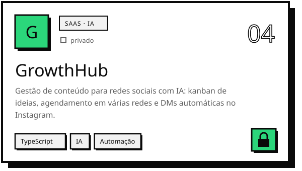</picture>
  <a href="https://github.com/thalysm/duo"><picture><source media="(prefers-color-scheme: dark)" srcset="assets/card-duo-dark.svg">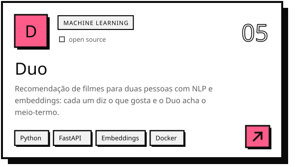</picture></a>
  <a href="https://github.com/thalysm/gameserverhub"><picture><source media="(prefers-color-scheme: dark)" srcset="assets/card-gameserverhub-dark.svg">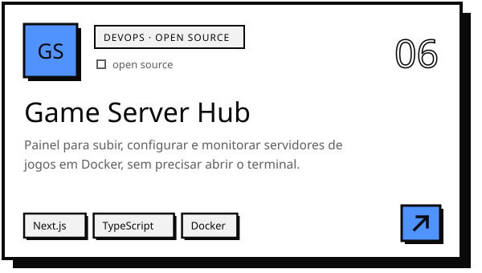</picture></a>
  <a href="https://www.behance.net/gallery/188599831/Redesign-portal-CODAU"><picture><source media="(prefers-color-scheme: dark)" srcset="assets/card-codau-dark.svg">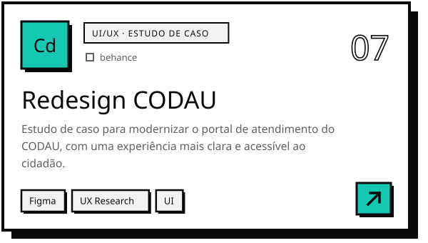</picture></a>
  <a href="https://www.behance.net/gallery/176429071/bLeave-A-UI-Case-Study"><picture><source media="(prefers-color-scheme: dark)" srcset="assets/card-bleave-dark.svg">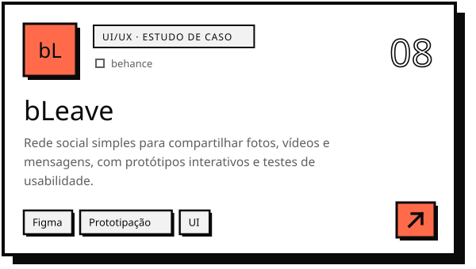</picture></a>

 

<picture><source media="(prefers-color-scheme: dark)" srcset="assets/section-blog-dark.svg"></picture>

<a href="https://thalys.btreedevs.com.br/blog/691bcddaf8261eaf8a8bf2b6"><picture><source media="(prefers-color-scheme: dark)" srcset="assets/post-duo-dark.svg">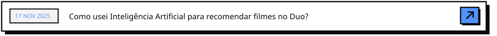</picture></a>
<a href="https://thalys.btreedevs.com.br/blog/691bc7c4f8261eaf8a8bf294"><picture><source media="(prefers-color-scheme: dark)" srcset="assets/post-coolify-dark.svg">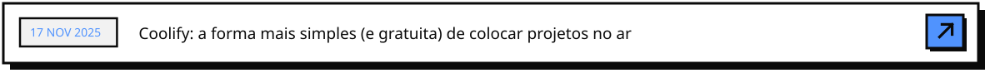</picture></a>
<a href="https://thalys.btreedevs.com.br/blog/691a7d0b1c4d4f1e8a3fcf30"><picture><source media="(prefers-color-scheme: dark)" srcset="assets/post-hello-dark.svg">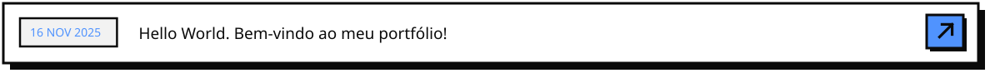</picture></a>

  

<picture><source media="(prefers-color-scheme: dark)" srcset="assets/section-atividade-dark.svg">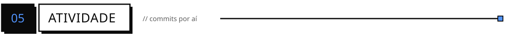</picture>

<picture>
  <source media="(prefers-color-scheme: dark)" srcset="https://raw.githubusercontent.com/thalysm/thalysm/output/snake-dark.svg">
  
</picture>

  

<picture><source media="(prefers-color-scheme: dark)" srcset="assets/footer-dark.svg">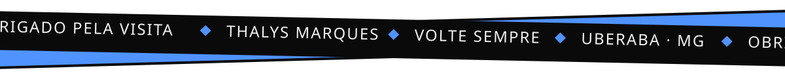</picture>
